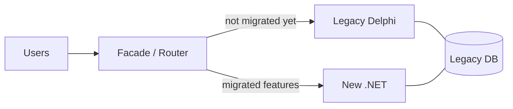

# 01 — System Modernization Fundamentals

## What is legacy modernization?

Modernization is the process of evolving an existing system so it keeps (or regains) its ability to
**deliver business value at an acceptable cost and risk**. It is *not* "rewrite everything in the new
shiny language". The legacy system usually:

- **Works** and runs the business today (it pays salaries).
- Contains **decades of undocumented business rules** (often only in the code).
- Is **hard to change**: high coupling, no tests, few people who understand it.
- Has **platform risk**: outdated runtime, unsupported libraries/DB, hard-to-hire skills, Windows-only desktop.

> Key sentence for the interview: *"Legacy is code that makes money but is scary to change. The goal of
> modernization is to make change cheap and safe again — the technology switch is a means, not the end."*

## Why companies modernize (business drivers)

| Driver | Example in a Delphi system |
|---|---|
| Talent / hiring | Few Delphi developers available, expensive and aging market |
| Time to market | Every new feature takes weeks because of coupling and fear of regression |
| Platform / delivery | Desktop app installed on each machine; customers want web, mobile, SaaS, cloud |
| Integration | Hard to expose APIs, integrate with partners, e-commerce, government services (e.g. NF-e) |
| Scalability | Client-server (2-tier) with fat client talking directly to the DB |
| Security / compliance | Old libraries, no centralized auth, LGPD/GDPR concerns, no audit trail |
| Cost | Licenses (Delphi, old DB), infrastructure, maintenance |

Always tie technical decisions back to **business outcomes**. Interviewers love that.

## Modernization strategies — the "R's"

A common classification (variations from Gartner and AWS):

| Strategy | What it means | When it fits |
|---|---|---|
| **Retain** | Keep as is | Stable, low-change area; not worth it now |
| **Retire** | Turn it off | Feature nobody uses (measure first!) |
| **Rehost** ("lift and shift") | Same app, new infrastructure (e.g. VM in the cloud, RemoteApp/Citrix) | Quick win for infra, no code change |
| **Replatform** | Small changes to run on a new platform (e.g. new DB version, containers) | Reduce infra/licensing cost |
| **Refactor** | Improve internal structure without changing behavior | Code is valuable but messy |
| **Rearchitect** | Change the architecture (e.g. 2-tier desktop → web + API) | Current architecture blocks the business |
| **Rebuild / Rewrite** | Rewrite from scratch with new tech | Code is a liability, but rules are understood |
| **Replace / Repurchase** | Buy a SaaS/ERP product | Non-differentiating domain (payroll, accounting) |

A Delphi → .NET migration is typically **Rearchitect + Rebuild, done incrementally**, and different
modules can get different strategies (e.g. *retire* reports nobody uses, *replace* the HR module with a
SaaS, *rebuild* the core domain in .NET).

## Big Bang rewrite vs. Incremental migration

### Big Bang (rewrite everything, switch on a single day)

- ❌ Years without delivering value; the business keeps changing the old system meanwhile ("moving target").
- ❌ The new system must reach **feature parity** before anyone uses it → hidden rules are discovered too late.
- ❌ Huge cut-over risk: one day, everything changes. Rollback is very hard.
- ✅ Only reasonable for small systems or when the old platform is literally dying.

> Joel Spolsky's classic essay *"Things You Should Never Do"* (Netscape rewrite) is the famous reference.

### Incremental (evolutionary) migration — **the preferred answer**

- Deliver in small slices, **each slice in production** generating value and feedback.
- Old and new systems **coexist** for a period (hybrid phase).
- Risk is spread, rollback is per slice, learning happens early.
- ❌ Cost: you need **integration/coexistence infrastructure** (shared data, sync, routing, ACL) that will be thrown away later. That is the price of lower risk — say it explicitly.

## The core incremental patterns

### Strangler Fig (Martin Fowler)

Named after a fig tree that grows around a host tree until it replaces it.

1. Put a **façade / routing layer** in front of the legacy system.
2. Build a new capability in the new system.
3. Route that capability to the new system.
4. Repeat until the legacy is "strangled", then remove it.

In web systems the façade is usually a reverse proxy (e.g. **YARP** in .NET). In a **Delphi desktop**
system there is no HTTP to intercept, so the "façade" is typically one of these (see doc 02):

- The Delphi menu/launcher opens **new screens built in web** (browser or embedded WebView2/`TEdgeBrowser`).
- Delphi code calls a **new .NET API** instead of its own business logic for migrated features.
- A new web portal replaces a **whole module/user group** at once (e.g. "sales reps use the web app; back office stays on Delphi for now").

### Anti-Corruption Layer (ACL) — from DDD

A translation layer between the new model and the legacy model, so the **legacy's bad naming,
structure and assumptions do not leak into the new code**.

Example: the legacy table `TB_CLI` has `FLG_ST = 'A' | 'I' | 'B'` and `DT_CAD` as a string. The ACL
translates it to a clean `Customer` with `CustomerStatus.Active | Inactive | Blocked` and a `DateOnly`.

### Branch by Abstraction

1. Create an abstraction (interface) in front of the code to be replaced.
2. Make all callers use the abstraction.
3. Create the new implementation behind it.
4. Switch (via config/feature flag), then delete the old implementation.

Great for replacing a component **inside** a codebase without a long-lived git branch.

### Parallel Run / Dark Launch

Run old and new implementations **side by side with the same input** and compare outputs; only the
legacy result is used until confidence is high. Perfect for **calculations** (taxes, prices, payroll,
commissions) where Delphi rules are subtle (rounding, dates). Tools: the *Scientist* pattern (in .NET:
the `Scientist.NET` library).

### Feature Toggles

Turn the new path on per customer / branch / user group (canary). Enables gradual rollout and instant
rollback. In .NET: `Microsoft.FeatureManagement`.

### Event Interception / Change Data Capture (CDC)

Capture changes from the legacy (DB triggers, CDC, transaction log via Debezium) and publish them as
events so new services stay in sync without changing legacy code much. See doc 07 and doc 08.

## The modernization process (a roadmap you can explain)

1. **Discover / Assess**
   - Inventory: modules, forms, units, DB objects (tables, procedures, triggers), integrations, reports, batch jobs.
   - Static analysis: dependencies between units, size, complexity, dead code.
   - **Talk to users**: which features are used, what hurts the most. Collect usage metrics if possible.
   - Identify business capabilities and **domains** (DDD, Event Storming — doc 04).
2. **Define the target architecture and principles**
   - Usually a **modular monolith** on .NET with Clean Architecture inside each module (docs 03, 05).
   - Decisions written as **ADRs** (Architecture Decision Records).
3. **Build the safety net**
   - Characterization tests around legacy behavior, reference datasets, observability (doc 09).
   - CI/CD for the new platform from day 1.
4. **Build the coexistence infrastructure**
   - Integration strategy: shared DB? API? events? Authentication shared between both worlds.
5. **Pick the first slice wisely**
   - Valuable but **low risk**, few dependencies, clear boundaries (a "thin vertical slice").
   - It proves the architecture, the pipeline and the integration end to end.
6. **Migrate slice by slice** (strangler), measure, adjust.
7. **Migrate data** per bounded context; decommission legacy parts as soon as possible.
8. **Decommission** the legacy. Celebrate. (Plan this explicitly or the hybrid lives forever.)

## Prioritization: what to migrate first?

Score each module/capability by:

- **Business value** of changing it (how often the business asks changes there).
- **Pain / risk** in the legacy (bugs, incidents, performance).
- **Coupling / complexity** (how hard to extract).
- **Strategic importance** (core domain vs. supporting vs. generic — doc 04).

A good first candidate: high value/pain, low coupling. Avoid starting with the most critical core
(e.g. invoicing/fiscal) — start with something that lets the team learn the patterns.

## Main risks and how to mitigate

| Risk | Mitigation |
|---|---|
| Hidden business rules | Characterization tests, parallel run, pair with legacy devs and key users |
| Scope creep ("since we're rewriting, let's change everything") | Separate *migration* from *redesign*; agree on parity vs. improvements per slice |
| Hybrid phase becomes permanent | Explicit decommission milestones; measure % migrated |
| Data inconsistency between old/new | Single source of truth per entity at any moment; reconciliation jobs |
| Team knowledge (Delphi vs .NET) | Mixed teams, pairing, documentation of rules discovered |
| Over-engineering (microservices too early) | Start with modular monolith; evolve when there is evidence |
| Performance regressions | Baselines from legacy, load tests, observability |
| User resistance | Involve key users early, gradual rollout, training |

## Key vocabulary

- **Technical debt**: the implied cost of future rework caused by shortcuts.
- **Big ball of mud**: a system with no recognizable architecture.
- **Seam** (Michael Feathers): a place where you can change behavior without editing in that place — where you cut the legacy.
- **Characterization test**: a test that documents what the system *does* (not what it *should* do).
- **Feature parity**: the new system does everything the old one did (often a trap — not every feature deserves to survive).
- **Cut-over**: the moment you switch from old to new.
- **Coexistence / hybrid period**: old and new running together.
- **ADR**: short document recording an architecture decision, its context and consequences.

## Recommended references

- *Working Effectively with Legacy Code* — Michael Feathers
- *Monolith to Microservices* — Sam Newman (excellent for migration patterns)
- *Kill It with Fire* — Marianne Bellotti (modernization from a business/organization perspective)
- *Domain-Driven Design* — Eric Evans; *Implementing DDD* — Vaughn Vernon
- Martin Fowler's articles: *StranglerFigApplication*, *BranchByAbstraction*, *MonolithFirst*
