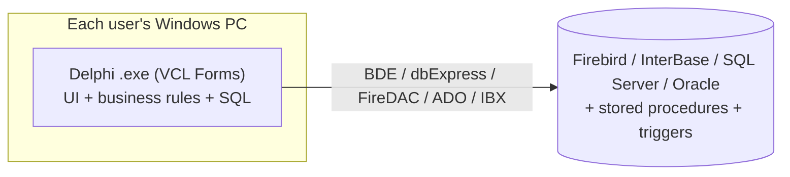
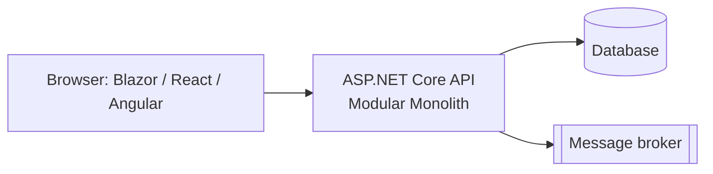

# 02 — Delphi → .NET: What You Need to Know

This is the most job-specific document. Interviewers will want to see that you understand **what a
typical Delphi system looks like inside** and the concrete traps of moving it to .NET.

## Anatomy of a typical legacy Delphi system

Most corporate Delphi systems (Delphi 5/7/2007 up to XE/10.x/11/12) follow the **RAD client-server
(2-tier)** style:

Typical characteristics:

- **VCL Forms** (`.pas` + `.dfm`) — the screens. The `.dfm` holds component properties, sometimes even SQL.
- **Business logic inside event handlers**: `btnSaveClick`, `OnExit` of an edit, `BeforePost`/`AfterScroll` of a dataset. UI and rules are mixed ("smart UI" anti-pattern).
- **Data-aware controls** (`TDBEdit`, `TDBGrid`) bound directly to datasets (`TQuery`, `TClientDataSet`, `TFDQuery`) — the UI *is* the data access layer.
- **DataModules** (`TDataModule`) with shared, global connections and queries.
- **Global variables and singletons**: forms auto-created at startup, `frmMain.User`, global state everywhere.
- **Logic in the database**: stored procedures, triggers, generators/sequences — often a big part of the rules.
- **Reports**: QuickReport, FastReport, Rave, ReportBuilder — often underestimated in estimates!
- **Integrations**: file import/export (TXT, CSV fixed-width), COM/OLE (Excel, Word), DLLs, Indy sockets, sometimes DataSnap (3-tier).
- **Packages (`.bpl`) and third-party components**: DevExpress, TMS, JEDI, RxLib… some abandoned.
- **Windows-only**, installed per machine, updates via shared folders/launchers.

## Delphi ↔ .NET concept mapping

| Delphi | .NET equivalent / target |
|---|---|
| Object Pascal unit (`.pas`) | C# file / namespace |
| `.dpr` / `.dproj` / `.bpl` | `.sln`/`.slnx`, `.csproj`, class library / NuGet |
| VCL Forms | Web (Blazor, React/Angular + ASP.NET Core API) or desktop (WinForms, WPF, Avalonia, MAUI) |
| `TDataModule` | Repositories / `DbContext` + application services (DI, not globals) |
| `TDataSet`, `TClientDataSet`, `TFDQuery` | EF Core / Dapper + DTOs; no direct UI-to-DB binding |
| BDE / dbExpress / FireDAC / IBX | ADO.NET providers (`Microsoft.Data.SqlClient`, `FirebirdSql.Data.FirebirdClient`, Npgsql, Oracle) |
| Event handlers with rules | Application layer use cases (commands/handlers) + domain model |
| Global variables / auto-created forms | Dependency Injection (`IServiceCollection`) with explicit lifetimes |
| `try..except` / `try..finally` | `try/catch` / `try/finally`, `using` (IDisposable) |
| `TStringList`, `TList`, `TObjectList` | `List<T>`, `Dictionary<TKey,TValue>` |
| Manual memory (`Free`, `FreeAndNil`) | Garbage collector (+ `IDisposable` for resources) |
| `Currency` type (fixed point, 4 decimals) | `decimal` (**never** `double` for money) |
| `TDateTime` (a `Double`, days since 1899-12-30) | `DateTime`/`DateOnly`/`DateTimeOffset`; `DateTime.FromOADate()` uses the same epoch |
| Strings 1-based (`Copy(s, 1, 3)`) | Strings 0-based (`s.Substring(0, 3)`) — classic off-by-one source |
| `AnsiString` (pre-2009) / `UnicodeString` (2009+) | `string` (UTF-16); watch DB charsets (e.g. WIN1252) |
| Threads (`TThread`, `Synchronize`) | `async/await`, `Task`, `BackgroundService`/`IHostedService` |
| Timer-based batch jobs in a form | Worker Services, Hangfire, Quartz.NET |
| DataSnap / RemObjects | ASP.NET Core Web API, gRPC |
| QuickReport / FastReport | FastReport .NET, QuestPDF, SSRS, Telerik/DevExpress reports |
| INI files / Registry config | `appsettings.json`, environment variables, Options pattern, Key Vault |

## Traps that cause "it gives a different result" bugs

These are great details to mention — they show real migration experience:

1. **Floating point & money**: legacy may use `Double`/`Extended` (80-bit on Win32!) or `Currency`. .NET `double` is 64-bit → tiny differences. Use `decimal` and validate with characterization tests.
2. **Rounding**: Delphi `Round` uses banker's rounding (round half to even), as does .NET's `Math.Round` by default — but the legacy may use `SimpleRoundTo`, `Trunc`, custom functions or SQL rounding. Be explicit: `Math.Round(x, 2, MidpointRounding.AwayFromZero)` when that is the business rule.
3. **Dates**: `TDateTime` as double, time zones ignored (local time everywhere), `StrToDate` depending on Windows regional settings (`dd/mm/yyyy` vs `mm/dd/yyyy`). Use invariant/explicit cultures in .NET.
4. **String indexes** (1-based vs 0-based), `Pos` returning 0 when not found vs `IndexOf` returning -1.
5. **Encoding**: ANSI files and DB columns (Windows-1252/Latin1) vs UTF-8/UTF-16. Fixed-width text file layouts break with multi-byte characters. In .NET Core you need `CodePagesEncodingProvider` to use Windows-1252.
6. **Null handling**: Delphi `Field.AsString` returns `''` for NULL, `AsInteger` returns `0`. Legacy logic often treats empty and NULL the same — the new code must reproduce or consciously change that.
7. **Implicit transactions**: legacy may rely on auto-commit or on the component's transaction behavior; .NET code must define transaction boundaries explicitly (Unit of Work).
8. **Event order side effects**: rules in `OnExit`, `OnChange`, `BeforePost` run in a specific order the user never sees. Document them as explicit rules.
9. **Triggers & stored procedures**: rules that the Delphi code doesn't show. Read the DB, not just the `.pas`.
10. **Sorting & collation**: DB collation (case/accent insensitive) vs C# ordinal comparisons.

## Migration approaches for a Delphi system

### A. Automatic code conversion (Delphi → C#)

There are converters/tools, but they translate the **architecture problems too** (rules inside UI,
globals, datasets). Useful at most for isolated algorithms (e.g. calculation units). Generally *not*
recommended as the main strategy. AI assistants can speed up translating isolated units, but **every
translated rule must be covered by tests**.

### B. Rewrite as a new desktop app (WinForms/WPF)

- Closest to the users' current workflow; WinForms is the most similar to VCL.
- Still Windows-only, still requires installation. OK when the business really needs a desktop (hardware integration, offline, heavy data entry).
- Should still use a layered/clean architecture with an API or at least separated logic.

### C. Rearchitect to Web + API (most common target)

- Centralized deploy, multi-platform, easier integration, cloud/SaaS ready.
- Requires UX redesign (grids, keyboard shortcuts, F-key navigation — Delphi users are *very* fast with keyboard; don't ignore this!).

### D. Incremental hybrid (Strangler) — **what to recommend**

Steps that work well with Delphi desktop systems:

1. **Stabilize & understand**: put the Delphi code in version control (if not already), automated build, inventory modules, map DB objects.
2. **Extract rules behind an API**: create the .NET API (modular monolith). For a chosen feature, the Delphi app calls the .NET API (Delphi has `TRESTClient`/`THTTPClient`/Indy) instead of executing its own SQL/rules. Now the rule lives in one place.
3. **New screens in the new UI**: new features are built *only* in .NET/web. The Delphi menu can open them in the browser or embedded with **WebView2 (`TEdgeBrowser`, Delphi 10.4+)**. Share authentication (SSO/token passed to the web view).
4. **Migrate module by module** (by bounded context), retiring the corresponding Delphi forms.
5. **Data**: start with the **shared database** (pragmatic), then move ownership of tables to the new modules, using ACL/views/CDC to keep the legacy working (doc 08).
6. **Decommission** the Delphi executable when the last module is gone.

Other interop options (useful to know, use carefully):

- .NET calling a Delphi **DLL** via P/Invoke (`[DllImport]`/`[LibraryImport]`, `stdcall`, careful with strings — use `PWideChar`/`WideString` or buffers).
- Delphi calling .NET via **COM** (.NET COM-visible component) — possible but painful; prefer HTTP.
- Running legacy and new side by side via **DB integration** (both read/write same tables) — easy start, but the most coupling. Have a plan to end it.

## What to discover during assessment (checklist)

- [ ] Delphi version, third-party component packs, licenses, source code availability (all of it compiles?)
- [ ] Number of units, forms, LOC; which forms are actually used (usage logs, users)
- [ ] Database engine/version, number of tables, procedures, triggers, size, charset
- [ ] Where business rules live: forms, data modules, procedures, triggers
- [ ] Integrations: files, DLLs, COM, web services, fiscal/government, banks, devices (printers, scales, POS)
- [ ] Reports (count, complexity) and batch processes
- [ ] Security model: users/permissions table, DB users, passwords in INI files?
- [ ] Deployment: how updates reach users; multi-tenant? one DB per customer?
- [ ] Who knows the system (people are a critical "dependency")
- [ ] Pain points: incidents, slow screens, most requested changes

## Phrases that show seniority

- *"I'd first separate what the system does from how it's built: catalog business capabilities, then decide strategy per capability."*
- *"I would not port the dataset-bound-to-grid architecture; I'd extract the rules into a domain/application layer and expose them through an API, so the Delphi UI and the new UI can use the same rule during the transition."*
- *"For calculations I'd use characterization tests with real production samples and a parallel run before switching."*
- *"New features only in the new platform — otherwise the legacy keeps growing and the migration never ends."*
