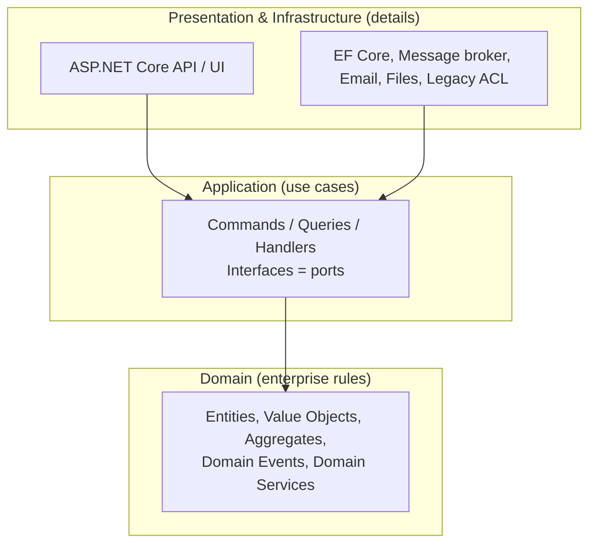

# 03 — Clean Architecture

## The idea

Clean Architecture (Robert C. Martin, 2012), like Hexagonal (Ports & Adapters, Alistair Cockburn) and
Onion (Jeffrey Palermo), says: **business rules are the center; frameworks, UI and database are
details at the edge.**

**The Dependency Rule**: source code dependencies point **inward only**. Inner layers know nothing
about outer layers.



| Layer | Contains | Depends on |
|---|---|---|
| **Domain** | Entities, value objects, aggregates, domain events, business invariants | Nothing (pure C#) |
| **Application** | Use cases (e.g. `PlaceOrder`), orchestration, transactions, interfaces (ports) like `IOrderRepository`, `IEmailSender`, DTOs | Domain |
| **Infrastructure** | Implementations (adapters): EF Core `DbContext`, repositories, broker clients, external APIs, legacy DB access | Application, Domain |
| **Presentation** | API controllers / Minimal API endpoints, Blazor, auth, model binding | Application |

**Dependency Inversion** makes it work: Application defines `IOrderRepository`; Infrastructure
implements it; DI container wires it at startup (composition root in the API project).

## Typical .NET solution layout

```
src/
  Sales.Domain/            -> Order, OrderItem, Money, OrderPlaced (event)
  Sales.Application/       -> PlaceOrderCommand, PlaceOrderHandler, IOrderRepository
  Sales.Infrastructure/    -> SalesDbContext, OrderRepository, LegacyCustomerGateway (ACL)
  Sales.Api/               -> endpoints, Program.cs (DI composition root)
tests/
  Sales.Domain.Tests/
  Sales.Application.Tests/
  Sales.Api.IntegrationTests/   (WebApplicationFactory + Testcontainers)
```

## Small example

```csharp
// Domain — no EF, no ASP.NET, no SQL
public sealed class Order
{
    private readonly List<OrderItem> _items = [];
    public Guid Id { get; } = Guid.NewGuid();
    public OrderStatus Status { get; private set; } = OrderStatus.Draft;
    public IReadOnlyList<OrderItem> Items => _items;
    public Money Total => _items.Aggregate(Money.Zero, (sum, i) => sum + i.Subtotal);

    public void AddItem(ProductId product, int quantity, Money unitPrice)
    {
        if (Status != OrderStatus.Draft) throw new DomainException("Order is closed.");
        if (quantity <= 0) throw new DomainException("Quantity must be positive.");
        _items.Add(new OrderItem(product, quantity, unitPrice));
    }
}

// Application — the use case + the port
public interface IOrderRepository
{
    Task<Order?> GetAsync(Guid id, CancellationToken ct);
    Task SaveAsync(Order order, CancellationToken ct);
}

public sealed record AddItemCommand(Guid OrderId, string ProductId, int Quantity, decimal UnitPrice);

public sealed class AddItemHandler(IOrderRepository orders)
{
    public async Task Handle(AddItemCommand cmd, CancellationToken ct)
    {
        var order = await orders.GetAsync(cmd.OrderId, ct) ?? throw new NotFoundException();
        order.AddItem(new ProductId(cmd.ProductId), cmd.Quantity, Money.Brl(cmd.UnitPrice));
        await orders.SaveAsync(order, ct);
    }
}

// Infrastructure — the adapter (could read the LEGACY tables during the transition!)
public sealed class OrderRepository(SalesDbContext db) : IOrderRepository { /* EF Core */ }
```

## Why Clean Architecture helps modernization

This is the important part for the interview:

1. **It is the exact opposite of the Delphi "smart UI"**. In the legacy, rules live in `OnClick`
   handlers coupled to datasets. Clean Architecture forces rules into the Domain/Application layers,
   testable without UI or DB.
2. **The database becomes a replaceable detail**. During the migration the repository adapter can read
   and write the **legacy tables** (through an Anti-Corruption Layer). Later, when the data migrates to
   a new schema, you swap only the adapter — the domain and use cases don't change.
3. **The UI becomes a replaceable detail**. The same use case can be called by the new web API **and**
   by the Delphi app (via HTTP) during the hybrid period, or by a background worker.
4. **Testability = safety net**. Domain and use cases are unit-testable; the rules discovered in the
   legacy get encoded as tests.
5. **Frameworks can evolve**: .NET versions, ORM, broker — upgrades are contained in Infrastructure, so
   you don't create the *next* legacy system.

## Pitfalls / criticisms (show balanced judgment)

- **Over-engineering**: for simple CRUD modules (e.g. registering cities), full layers + mappers +
  handlers is ceremony. It's fine to use a simpler approach per module (a modular monolith allows
  different internal architectures per module).
- **Anemic domain**: if entities are only getters/setters and all logic sits in handlers, you have
  layers but not the benefit. Put invariants inside the domain.
- **Too many projects**: four projects per module × 15 modules = slow builds and confusion. Folders
  + architecture tests can enforce boundaries as well.
- **Repository over EF Core**: debated; EF Core `DbContext` is already a Unit of Work + repository.
  A pragmatic answer: use repositories for aggregates (domain-focused), query directly for read models (CQRS).

## Related: Vertical Slice Architecture

Organize code **by feature** (`Features/Orders/PlaceOrder.cs` containing request, handler, validation,
endpoint) instead of by technical layer. Fits well with migration because **each migrated legacy
screen/feature becomes one slice**. Many teams combine: modular monolith → each module organized as
vertical slices → rich domain where complexity justifies it.

## CQRS (Command Query Responsibility Segregation)

Separate **writes** (commands, go through the domain model, enforce invariants) from **reads**
(queries, can go straight to the DB with Dapper/SQL/views and return DTOs).

Why it helps in modernization: legacy systems are **read-heavy with complex grids and reports**.
Queries can read legacy tables/views directly and fast, while commands go through the new clean domain.
CQRS does **not** require separate databases or event sourcing — that is an optional, more advanced step.

## How to enforce the rules

- Separate projects with references only pointing inward.
- **Architecture tests**: `NetArchTest.Rules` or `ArchUnitNET` — e.g. "Domain must not depend on
  Microsoft.EntityFrameworkCore".
- Code review and ADRs.
