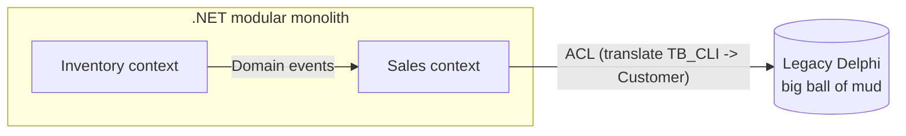

# 04 — Domain-Driven Design (DDD)

DDD (Eric Evans, 2003) is an approach where the **software model reflects the business domain**,
built in collaboration with domain experts. It has two parts:

- **Strategic DDD** — how to split a large system into coherent parts and how they relate. *(The most
  important part for modernization.)*
- **Tactical DDD** — building blocks to model the inside of each part.

## Strategic DDD

### Ubiquitous Language

A shared, precise vocabulary used by business people **and** in the code. In legacy systems, names are
often cryptic (`TB_MOV`, `FLG_TP`, `frmCad002`). Modernization is a chance to **rediscover the real
language**: "Is this a *Sale*, an *Order* or an *Invoice*? When does it become one?"

### Subdomains

| Type | Meaning | Strategy |
|---|---|---|
| **Core domain** | What makes the company different / earns money | Invest most: best people, rich model, rebuild carefully |
| **Supporting** | Necessary, specific to the business, not a differentiator | Simpler build, maybe CRUD |
| **Generic** | Solved problems (auth, email, payroll, accounting) | Buy / use off-the-shelf / SaaS |

👉 This directly drives the **modernization strategy per area** (rebuild vs replace vs retain — doc 01).
Don't spend your best developers rewriting a generic module you could buy.

### Bounded Context

An explicit boundary in which a model and its language are consistent. The same word can mean
different things in different contexts:

- *Product* in **Catalog**: description, images, categories.
- *Product* in **Inventory**: quantity, location, lot.
- *Product* in **Billing/Fiscal**: tax code (NCM), CFOP, tax rates.

The legacy Delphi system usually has **one giant `TB_PRODUTO` table with 150 columns** serving all of
these. Bounded contexts tell you how to split it.

**Bounded contexts are the natural units of migration**: each one becomes a **module** in a modular
monolith (doc 05) or, later, possibly a microservice (doc 06). Migrate context by context.

### Context Mapping

Describes relationships between bounded contexts (and teams):

| Pattern | Meaning |
|---|---|
| **Anti-Corruption Layer (ACL)** | A translation layer protecting your model from another (legacy!) model |
| **Open Host Service / Published Language** | A context exposes a well-defined API/contract for others |
| **Customer–Supplier** | Upstream supplies what downstream needs; they negotiate |
| **Conformist** | Downstream simply adopts the upstream model (no power to change it) |
| **Shared Kernel** | Two contexts share a small part of the model (use sparingly) |
| **Separate Ways** | No integration at all |
| **Partnership** | Two teams evolve together with coordinated planning |

In modernization the **legacy system is just another bounded context** (often a "big ball of mud"),
and every new context talks to it **through an ACL**.



### Event Storming (discovery technique)

A workshop (Alberto Brandolini) where domain experts and devs place **domain events** (orange sticky
notes, past tense: *OrderPlaced*, *InvoiceIssued*, *PaymentReceived*) on a timeline, then add commands,
actors, policies, aggregates and external systems. Clusters of events reveal **bounded contexts**.

In modernization: run Event Storming with key users **before** reading thousands of lines of Delphi
code — it gives you the map; the code gives you the details. Also extremely good to find rules that
"everybody knows" but nobody wrote down.

## Tactical DDD (building blocks)

| Building block | Description | Example |
|---|---|---|
| **Entity** | Has identity that persists over time | `Customer`, `Order` |
| **Value Object** | Defined by its values, immutable, self-validating | `Money`, `Cpf`, `Email`, `Address`, `DateRange` |
| **Aggregate** | Cluster of objects treated as a unit for consistency; has a **root** | `Order` (root) + `OrderItem`s |
| **Aggregate Root** | Only entry point to modify the aggregate; enforces invariants | `order.AddItem(...)` not `order.Items.Add(...)` |
| **Domain Event** | Something relevant that happened in the domain | `OrderPlaced`, `StockReserved` |
| **Domain Service** | Domain logic that doesn't belong to a single entity | `ShippingCostCalculator` |
| **Repository** | Collection-like access to aggregates | `IOrderRepository` |
| **Factory** | Encapsulates complex creation | `Order.CreateFromQuote(quote)` |

Aggregate design rules (Vaughn Vernon):

1. Protect **true invariants** inside the aggregate boundary.
2. Design **small aggregates**.
3. Reference other aggregates **by ID only**.
4. Use **eventual consistency** (domain events) between aggregates/contexts.

### Value Object example (replacing a legacy primitive)

```csharp
// Legacy: CPF stored as VARCHAR(14), sometimes with mask, sometimes without, validated in OnExit.
public sealed record Cpf
{
    public string Value { get; }
    private Cpf(string value) => Value = value;

    public static Cpf Create(string raw)
    {
        var digits = new string(raw.Where(char.IsDigit).ToArray());
        if (digits.Length != 11 || !IsValidCheckDigits(digits))
            throw new DomainException("Invalid CPF.");
        return new Cpf(digits);
    }

    private static bool IsValidCheckDigits(string d) { /* ... */ return true; }
}
```

Now the rule exists in one place instead of being copy-pasted across 20 forms. This is a typical
"primitive obsession" fix you get during modernization.

## How DDD helps modernization (summary)

1. **Finds the seams**: bounded contexts show where to cut the monolith and in what order to migrate.
2. **Prioritizes investment**: core vs supporting vs generic decides rebuild vs buy vs keep.
3. **Protects the new model**: ACL keeps legacy concepts and naming from contaminating the new code.
4. **Recovers knowledge**: ubiquitous language + Event Storming extract implicit rules from people.
5. **Drives data ownership**: each context owns its data → plan to split the giant shared database.
6. **Enables messaging**: domain events become integration events between modules/services (doc 07).

## Pitfalls

- Applying tactical DDD (aggregates, events) to **simple CRUD** — overkill.
- Contexts split by **technical layers** or by DB tables instead of business capabilities.
- Modeling without domain experts ("DDD in a dark room").
- Huge aggregates (loading the whole customer with all orders to change an address).
