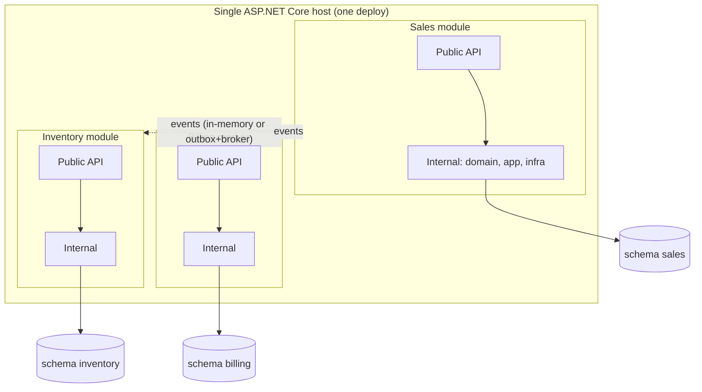

# 05 — Modular Monolith

## Definition

A **single deployable application** internally divided into **highly cohesive, loosely coupled
modules**, each aligned to a **bounded context** (doc 04), with:

- Its own **public API/contract** (other modules can only use that).
- Its own **internal implementation** (hidden — `internal` in C#).
- Its own **data** (separate schema or at least separate tables, no cross-module joins/writes).
- Communication through **in-process calls to public contracts** or **in-process/async events**.



Monolith vs "big ball of mud": the problem with legacy was never that it was *one deploy*; it was the
**lack of boundaries**. A modular monolith keeps the simplicity of one deploy and adds boundaries.

## Why it is usually the best target for a Delphi → .NET migration

| Benefit | Why it matters here |
|---|---|
| **Simple operations** | One deploy, one process, one DB server. The team is already learning a new stack; don't add Kubernetes + distributed systems at the same time |
| **No network between modules** | No latency, no partial failures, no distributed transactions |
| **Easy refactoring of boundaries** | You *will* get the boundaries wrong at first (legacy hides them). Moving code between modules in one repo is cheap; between microservices it's expensive |
| **Transactions available** | When needed, ACID transactions still work (but prefer eventual consistency between modules to keep them decoupled) |
| **Path to microservices** | A well-isolated module (own data, communicates by contracts/events) can be extracted to a service later, when there is a real reason |
| **Matches the strangler approach** | Each migrated legacy area becomes a new module; the legacy shrinks as modules grow |

> Martin Fowler — *"MonolithFirst"*: almost all successful microservice stories started with a monolith
> that got too big; systems built as microservices from scratch often ended up in serious trouble.

## Implementation in .NET

### Structure

```
src/
  Host/                         -> ASP.NET Core app, wires all modules (Program.cs)
  Modules/
    Sales/
      Sales.Contracts/          -> public: integration events, public DTOs, ISalesModule
      Sales.Core/               -> internal: domain + application + infrastructure (or split in 3)
    Inventory/
      Inventory.Contracts/
      Inventory.Core/
  Shared/
    BuildingBlocks/             -> technical only: Result, base Entity, outbox, event bus abstraction
```

Rule: **a module may reference only other modules' `Contracts` projects**, never their `Core`.

### Module registration

```csharp
// Sales.Core
public static class SalesModule
{
    public static IServiceCollection AddSalesModule(this IServiceCollection services, IConfiguration config)
    {
        services.AddDbContext<SalesDbContext>(o =>
            o.UseSqlServer(config.GetConnectionString("Main"),
                sql => sql.MigrationsHistoryTable("__EFMigrationsHistory", "sales")));
        services.AddScoped<IOrderRepository, OrderRepository>();
        return services;
    }

    public static IEndpointRouteBuilder MapSalesEndpoints(this IEndpointRouteBuilder app) { /* ... */ return app; }
}

// Host/Program.cs
builder.Services.AddSalesModule(builder.Configuration)
                .AddInventoryModule(builder.Configuration);
app.MapSalesEndpoints();
app.MapInventoryEndpoints();
```

### Data isolation

- One **DB schema per module** (`sales.Orders`, `inventory.StockItems`), one `DbContext` per module
  with `HasDefaultSchema("sales")`.
- **No foreign keys or joins across modules**; reference other modules' data by ID.
- If a module needs data from another: call its public API, or keep a **local read copy** updated by
  events.

### Communication between modules

1. **Synchronous**: call the other module's public interface (e.g. `IInventoryModule.GetStock(productId)`)
   — simple, but creates temporal coupling.
2. **Asynchronous events**: `OrderPlaced` integration event → Inventory reacts. Use an in-memory bus to
   start, and the **Outbox pattern** for reliability (doc 07). Switching later to RabbitMQ/Azure Service
   Bus makes module extraction to a service almost transparent.

### Enforcing boundaries

- `internal` classes + `InternalsVisibleTo` only for that module's tests.
- **Architecture tests** (NetArchTest / ArchUnitNET):

```csharp
[Fact]
public void Sales_should_not_depend_on_inventory_internals()
{
    var result = Types.InAssembly(typeof(SalesModule).Assembly)
        .ShouldNot().HaveDependencyOn("Inventory.Core")
        .GetResult();
    Assert.True(result.IsSuccessful);
}
```

## Mapping legacy to modules

1. Identify bounded contexts (Event Storming, legacy menus, DB table clusters, which forms use which tables).
2. Build a **table ownership matrix**: for each legacy table, which context writes it, which only reads.
3. Tables written by a single context → easy to move into that module.
4. Tables written by many contexts (e.g. the god table `PRODUTO`) → split by context, use events/sync.
5. Start with the module with clear boundaries + business value; make the Delphi app use it via API.

## Pitfalls

- **Modules by technical layer** ("Repositories module", "Services module") — not modules at all.
- **Shared database tables between modules** — the coupling comes back through the DB.
- **"Common"/"Shared" project growing with business logic** — keep shared kernel technical and tiny.
- **Chatty synchronous calls between modules** — a sign the boundary is wrong.
- Lack of discipline: without architecture tests, boundaries erode in months.

## Interview one-liner

> *"I'd target a modular monolith on .NET: one deployable, modules aligned to bounded contexts, each
> with its own schema and public contract, communicating via events with an outbox. It gives the team
> boundaries and testability without the operational cost of microservices, and keeps the option to
> extract a module into a service when scaling or team autonomy really requires it."*
