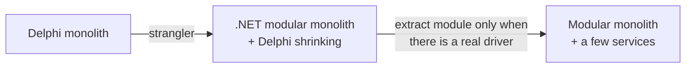
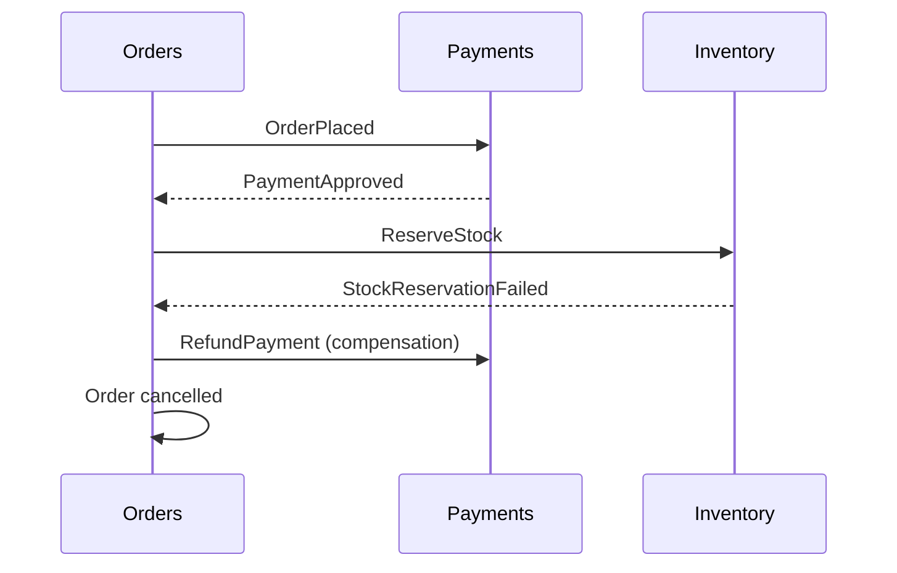

# 06 — Microservices

## Definition

An architecture where the system is composed of **small, independently deployable services**, each
owning a business capability (bounded context) and **its own data**, communicating over the network
(HTTP/gRPC/messaging), and typically owned by a single team.

Key characteristics:

- **Independent deployment** (the most important property — if you must deploy services together, you
  have a *distributed monolith*).
- **Database per service** — no other service reads your tables.
- **Decentralized governance** — each team chooses within guardrails.
- **Designed for failure** — timeouts, retries, circuit breakers.
- **Automation** — CI/CD, infrastructure as code, observability are mandatory, not optional.

## Benefits

- Independent **scalability** per service (scale only the hot part).
- **Team autonomy** — many teams deploy without coordinating (Conway's Law).
- **Fault isolation** — one service down doesn't take everything down (if designed well).
- **Technology flexibility** per service.

## Costs (the "microservices tax")

- **Distributed systems complexity**: network latency, partial failures, retries, idempotency.
- **Data consistency**: no ACID across services → **sagas** and **eventual consistency**.
- **Operations**: containers, orchestration (Kubernetes), service discovery, gateways, secrets, many pipelines.
- **Observability**: distributed tracing is mandatory (OpenTelemetry), correlation IDs, centralized logs.
- **Testing**: contract tests, integration environments.
- **Organizational**: requires mature DevOps culture and teams.

## Microservices in a modernization context

### When it makes sense

- Specific parts have **very different scaling** needs (e.g. a public price/catalog API vs back office).
- **Multiple teams** need to deliver independently.
- A **new capability** with a clear boundary that integrates with the legacy only via events/API.
- The organization already has the **platform** (CI/CD, containers, monitoring) and skills.

### When it doesn't (the usual case for a first Delphi migration)

- Small team (e.g. 3–8 devs) also learning a new stack.
- Boundaries are **still unknown** (legacy hides them) — wrong boundaries in microservices are very
  expensive to fix.
- No DevOps/platform maturity.
- Strong transactional consistency everywhere (fiscal/financial ERP flows).

> **The distributed monolith anti-pattern**: services that share the same database, must be deployed
> together, and call each other synchronously in long chains. You got all the costs of microservices
> and none of the benefits. Very common when a legacy monolith is split "by tables" or "by screens".

### Recommended evolution

Extraction is easy *if the module already*: owns its data (separate schema), communicates via
contracts/events (outbox + broker), and has no shared internals.

## Key patterns to know

| Pattern | Purpose | .NET tooling |
|---|---|---|
| **API Gateway / BFF** | Single entry point; routing, auth, aggregation; Backend-for-Frontend per client type | YARP, Ocelot, Azure API Management |
| **Strangler Fig via gateway** | Route `/orders/*` to new service, rest to legacy | YARP |
| **Database per service** | Data ownership and decoupling | EF Core per service |
| **Saga** | Long business transaction across services as a sequence of local transactions + **compensations** | MassTransit state machines, NServiceBus, Wolverine, Dapr workflows |
| **Choreography vs Orchestration** | Services react to events (decentralized) vs a coordinator tells each step (central) | — |
| **Outbox / Inbox** | Reliable event publishing / idempotent consumption | MassTransit, NServiceBus, Wolverine, custom |
| **Circuit breaker, retry, timeout** | Resilience | Polly / `Microsoft.Extensions.Http.Resilience` |
| **Service discovery & config** | Find services, central config | Kubernetes DNS, Aspire, Consul |
| **Distributed tracing** | Follow a request across services | OpenTelemetry + Jaeger/Tempo/App Insights |
| **Health checks** | Liveness/readiness | `AddHealthChecks()` |
| **API versioning / contracts** | Evolve without breaking consumers | `Asp.Versioning`, consumer-driven contract tests (Pact) |

### Saga example (order flow)

## Monolith vs Modular Monolith vs Microservices

| | Legacy monolith (big ball of mud) | Modular monolith | Microservices |
|---|---|---|---|
| Deploy | 1 | 1 | Many, independent |
| Boundaries | None | Logical, enforced in code | Physical (network) |
| Data | Shared everything | Schema per module | DB per service |
| Communication | Direct calls everywhere | Public contracts + events in-process | Network: HTTP/gRPC/messaging |
| Consistency | ACID | ACID inside module, eventual between | Eventual (sagas) |
| Ops complexity | Low | Low | High |
| Team scaling | Poor | Good up to a few teams | Best for many teams |
| Changing boundaries | — | Cheap | Expensive |

## Interview one-liner

> *"Microservices are a solution for organizational and scaling problems, not a goal. In a Delphi
> migration I'd start with a modular monolith, design modules as if they could be services (own data,
> async contracts), and extract only where there's a concrete driver — independent scaling, separate
> team, or different release cadence."*
