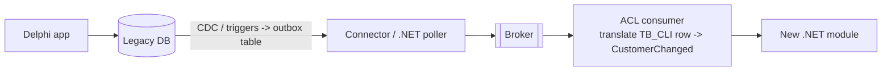

# 07 — Messaging & Event-Driven Integration

## Why messaging matters in modernization

During the hybrid period, the legacy and the new system must stay in sync, and the new modules must
be decoupled from each other. Messaging gives:

- **Decoupling in time**: producer and consumer don't need to be online at the same time.
- **Decoupling in knowledge**: the producer publishes "OrderPlaced" and doesn't know who listens.
- **Resilience**: if the consumer is down, messages wait in the queue (retry, dead-letter).
- **Load leveling**: spikes are absorbed by the queue (e.g. end-of-month invoice batch).
- **Incremental migration**: new consumers can be added (a new .NET module) without touching the producer (legacy).

## Core concepts

| Concept | Description |
|---|---|
| **Message** | Data sent between components (envelope: headers, ID, correlation ID, payload) |
| **Command** | Imperative, one handler, intent: `IssueInvoice`. Can be rejected |
| **Event** | Past fact, 0..N subscribers: `InvoiceIssued`. Can't be rejected, only reacted to |
| **Query** | Request for data (usually not via messaging) |
| **Queue (point-to-point)** | Each message processed by one consumer (competing consumers for scale) |
| **Topic / Exchange (pub-sub)** | Each subscriber gets its own copy |
| **Dead-letter queue (DLQ)** | Where messages go after failing N times — must be monitored |
| **Correlation ID** | Ties messages/logs of one business flow together |

### Domain events vs Integration events

- **Domain event**: inside a bounded context/module, in-process, rich domain types (`OrderPlaced` with
  the aggregate data). Often dispatched in the same transaction.
- **Integration event**: crosses module/service boundaries, a **public contract** — minimal, stable,
  versioned, primitive types only (`OrderPlacedV1 { OrderId, CustomerId, Total, OccurredAt }`).

Don't publish domain events directly as integration events — you'd couple consumers to your internal model.

## Delivery guarantees — the classic interview topic

- **At-most-once**: may lose messages.
- **At-least-once**: never lose, but **duplicates can happen** → most brokers in practice.
- **Exactly-once**: very hard end-to-end; in practice we achieve **effectively-once** = at-least-once
  delivery + **idempotent consumers**.

### Idempotent consumer

Processing the same message twice must have the same effect as once. Techniques:
- Store processed message IDs (**Inbox** table) and skip duplicates.
- Natural idempotency (`SET status = 'Paid'` instead of `balance = balance - x`).
- Unique constraints / upserts.

### The dual-write problem and the Transactional Outbox

Problem: saving to the DB and publishing to the broker are two different systems. If you save and the
publish fails (or the reverse), you are inconsistent.

**Outbox solution**:
1. In the **same DB transaction**, save the business change **and** a row in an `OutboxMessages` table.
2. A background process reads the outbox and publishes to the broker, marking rows as sent.
3. Consumers are idempotent (since the relay may publish twice).

```mermaid
sequenceDiagram
    participant H as Handler
    participant DB as Database
    participant R as Outbox Relay (BackgroundService)
    participant B as Broker
    H->>DB: BEGIN; INSERT Order; INSERT OutboxMessage; COMMIT
    R->>DB: SELECT unsent outbox messages
    R->>B: Publish OrderPlaced
    R->>DB: Mark as sent
```

## Brokers you should know

| Broker | Type | Notes |
|---|---|---|
| **RabbitMQ** | Message broker (queues, exchanges: direct/topic/fanout) | Very common, easy, on-prem friendly |
| **Azure Service Bus** | Managed broker (queues, topics, sessions, DLQ) | Azure-native, enterprise features |
| **Amazon SQS/SNS** | Managed queue + pub-sub | AWS-native |
| **Apache Kafka** | Distributed **log** (event streaming), retention, replay, partitions | High throughput, event streaming, CDC pipelines |
| **Redis Streams / Postgres-based queues** | Lightweight | For smaller needs |

.NET libraries: **MassTransit** (v8 open source; v9+ commercial license), **NServiceBus** (commercial),
**Wolverine** (open source), **Rebus**, **Brighter**, or the raw clients (`RabbitMQ.Client`,
`Azure.Messaging.ServiceBus`, `Confluent.Kafka`). They give retries, outbox, sagas, serialization, DLQ
handling out of the box. *(Being aware of the 2025 licensing changes — MediatR, AutoMapper and
MassTransit moved to commercial licenses — is a nice "I follow the ecosystem" detail.)*

## Messaging patterns for legacy integration

### 1. Change Data Capture (CDC) — legacy as an event source *without changing Delphi code*

Read the legacy database's transaction log and turn row changes into events.

- **Debezium** (Kafka Connect) supports SQL Server, Oracle, PostgreSQL, MySQL…
- SQL Server has native **CDC / Change Tracking**.
- For Firebird/older DBs: **triggers writing to an outbox/log table** + a .NET poller.



Caveat: CDC events are **low-level (row changed)**, not business events. Translate them in an ACL into
meaningful events, and be careful not to couple the new system to the legacy schema.

### 2. Legacy publishes via outbox table

If you can change the Delphi code a little: when saving, also insert into an `OUTBOX` table in the
same transaction. A .NET worker publishes. Delphi never talks to the broker directly.

### 3. New system writes back to legacy

When the new module becomes the owner of some data that legacy still reads, a consumer updates the
legacy tables (or the legacy reads views over the new tables) — **sync in one direction only**, with a
clear owner. Avoid bidirectional sync whenever possible (conflicts, loops).

### 4. Async batch replacement

Legacy jobs that ran in a timer on a form (`TTimer` + loop) → queue + .NET Worker Service consumers,
scalable and observable.

## Eventual consistency — how to explain it

"After an order is placed, the stock is reserved a few milliseconds/seconds later, not in the same
transaction. The UI must be designed for that (e.g. 'order received, processing'), and we need
compensation if something fails." Discuss with the business **which flows truly need immediate
consistency** — far fewer than people assume.

## Other topics to be ready for

- **Message ordering**: generally not guaranteed globally; use partition keys (Kafka) / sessions (ASB).
- **Poison messages**: retry with backoff, then DLQ + alert + reprocessing tooling.
- **Schema evolution / versioning**: add fields (backward compatible), never rename/remove in place; version event types.
- **Event sourcing** (store state as a sequence of events) ≠ event-driven architecture. Powerful for audit, but adds complexity; rarely needed for a first migration.
- **Request/Response over messaging** exists but HTTP/gRPC is simpler for queries.
